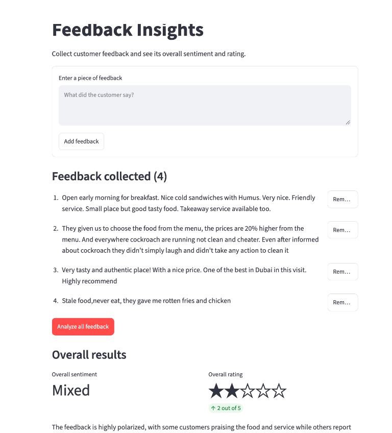

# Feedback Insights

Feedback Insights is a small customer-feedback analyzer. Enter feedback in the
Streamlit interface, submit all collected entries to the FastAPI service, and
see the overall sentiment, a 1–5 star rating, and a concise summary generated
with Google Gemini.



## Prerequisites

- Python 3.13 or newer
- [uv](https://docs.astral.sh/uv/) for Python environment and dependency management
- A Google Gemini API key with access to the `gemini-3.1-flash-lite` model

## Build and run

1. Open a terminal in the project directory.
2. Set your Gemini API key in the environment. Do not add the key to source
   files or commit it to Git.

   macOS/Linux:

   ```sh
   export GEMINI_API_KEY="your-gemini-api-key"
   ```

   PowerShell:

   ```powershell
   $env:GEMINI_API_KEY = "your-gemini-api-key"
   ```

3. Create the virtual environment and install the locked dependencies:

   ```sh
   uv sync --locked
   ```

4. Start the FastAPI backend in one terminal:

   ```sh
   uv run uvicorn app:app --reload
   ```

5. Start the Streamlit interface in a second terminal, from the same project
   directory and with `GEMINI_API_KEY` set:

   ```sh
   uv run streamlit run streamlit_app.py
   ```

6. Open the local URL printed by Streamlit, usually
   [http://localhost:8501](http://localhost:8501).

Streamlit sends the combined feedback to the backend's `POST /pookie` endpoint.
The backend calls Gemini and returns structured sentiment, rating, and summary
data. By default, the Streamlit app expects the API at
`http://127.0.0.1:8000`. To use another backend URL, set `FEEDBACK_API_URL` to
its base URL before starting Streamlit.

## Project files

- `app.py` — FastAPI service and `POST /pookie` endpoint
- `streamlit_app.py` — feedback collection and results interface
- `src/practice_fastapi_tbd/gemini.py` — Gemini client, prompt, and response
  validation
- `pyproject.toml` — project metadata and dependencies
- `uv.lock` — locked dependency versions used by `uv sync --locked`
- `images/feedback-insights.png` — application screenshot

## API request

Send feedback to `POST /pookie` as JSON:

```json
{
  "prompt": "Friendly staff and tasty food, but service was slow."
}
```

The response contains a sentiment (`Positive`, `Neutral`, `Negative`, or
`Mixed`), a rating from 1 to 5, and a short summary.
